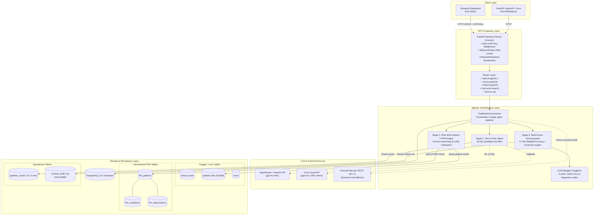
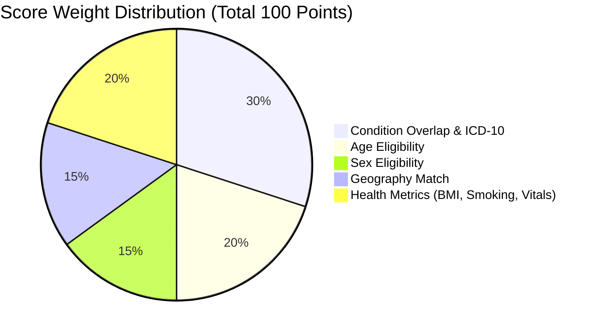

# TrialBridge System Architecture & Flow

TrialBridge is an AI-powered clinical trial patient screening and matching platform. It bridges clinical trial eligibility requirements with real-world patient records using a multi-agent screening and multifactor scoring pipeline.

---

## 1. High-Level System Architecture



---

## 2. End-to-End Match & Score Sequence

```mermaid
sequenceDiagram
    autonumber
    actor Clinician as Clinician / Researcher
    participant UI as Streamlit UI (:8501)
    participant API as FastAPI (:8000)
    participant Orch as TrialMatchOrchestrator
    participant S1 as Text-to-SQL Agent
    participant S2 as Root Word / Search Agent
    participant S3 as Scoring Agent
    participant Mapper as ICD10Mapper
    participant DB as PostgreSQL

    Clinician->>UI: Selects Trial (e.g. NCT05369065) + Data Source (Kaggle or FHIR)
    Clinician->>UI: Clicks "Run Scoring"
    UI->>API: POST /api/v1/agents/score-patients {trial_id, limit, source}
    API->>Orch: orchestrator.run_by_trial(trial_id, limit, source)
    
    rect rgb(25, 35, 45)
        note over Orch,DB: Step 1: Trial Fetch & Criteria Ingestion
        Orch->>DB: Query clinical_trials (by nct_id / UUID)
        alt Not in local DB
            Orch->>ClinicalTrialsGov: GET api/v2/studies/{NCT_ID}
            ClinicalTrialsGov-->>Orch: Study payload
            Orch->>DB: Upsert into clinical_trials
        end
        DB-->>Orch: Trial payload (conditions, eligibility criteria, demographics)
    end

    rect rgb(30, 40, 50)
        note over Orch,S1: Stage 1: Broad Pre-Filtering (Text-to-SQL)
        Orch->>DB: Check pipeline_cache (key = trial_id:source)
        alt Cache Miss
            Orch->>S1: generate_patient_filter_sql(criteria, source)
            S1->>S1: Generate schema-valid SELECT id FROM patients / fhir_patients
            S1->>DB: Execute pre-filter query
            DB-->>S1: Candidate patient IDs (e.g., 50 IDs)
            S1->>DB: Save to pipeline_cache (TTL 5 mins)
        else Cache Hit
            DB-->>Orch: Cached candidate IDs
        end
    end

    rect rgb(35, 45, 55)
        note over Orch,S2: Stage 2: Stemming Verification & Demographic Filtering
        alt source == "kaggle"
            Orch->>DB: Websearch tsvector query (@@) on conditions, ICD, demographics
        else source == "fhir"
            Orch->>DB: LATERAL JOIN fhir_conditions, fhir_observations (LOINC codes)
        end
        DB-->>Orch: Filtered cohort (demographics, conditions, vitals)
    end

    rect rgb(40, 50, 60)
        note over Orch,S3: Stage 3: Multi-Factor 0-100 Scoring
        Orch->>S3: Score verified patients against criteria
        S3->>Mapper: Map trial condition text -> ICD-10 prefixes (e.g., E11, I10)
        Mapper-->>S3: Canonical ICD-10 code set
        loop For Each Patient
            S3->>S3: Calculate Condition Fit (30 pts) [70% text match + 30% ICD overlap]
            S3->>S3: Calculate Age Fit (20 pts) [min_age, max_age range match]
            S3->>S3: Calculate Sex Fit (15 pts) [ALL / MALE / FEMALE validation]
            S3->>S3: Calculate Geography Fit (15 pts) [Country/City distance match]
            S3->>S3: Calculate Health/Vitals (20 pts) [BMI, Smoking status, General health]
            S3->>S3: Sum = Composite Score (0–100)
            S3->>S3: Evaluate Exclusion Criteria (Disqualified = Score 0, flagged excluded)
        end
        S3->>DB: Persist run into scoring_audit_log
        DB-->>S3: audit_log_id
    end

    Orch-->>API: Ranked candidate list + factor breakdowns + timings
    API-->>UI: 200 OK JSON response
    UI-->>Clinician: Renders interactive leaderboard, match summary, radar breakdown
```



---

## 3. Multi-Factor Scoring Engine Architecture

The scoring engine evaluates candidate patients along five distinct clinical axes for a total maximum score of 100 points:



### Detailed Breakdown Formulas

| Factor | Max Weight | Method | Evaluation Logic |
| :--- | :---: | :--- | :--- |
| **Condition Match** | **30 pts** | Hybrid Text & Code | $0.7 \times \text{TextMatchRatio} + 0.3 \times \text{ICD10OverlapRatio}$ |
| **Age Eligibility** | **20 pts** | Numeric Range | Full 20 pts if $\text{min\_age} \le \text{age} \le \text{max\_age}$; partial scaling if within 5-year boundary |
| **Sex Eligibility** | **15 pts** | Exact Match | 15 pts if trial accepts `ALL` or patient gender equals specified sex |
| **Geography** | **15 pts** | Proximity Match | 15 pts if country matches; bonus for city/state locality |
| **Health & Vitals** | **20 pts** | Multi-Parameter | BMI (8 pts) + Smoker status (6 pts) + General health status (6 pts) |
| **Exclusion Gate** | **Disqualifier** | Hard Binary Filter | If patient matches exclusion rules (e.g. end-stage organ failure), composite score set to `0` and marked `excluded: true` |

---

## 4. Dual-Data Pipeline: Kaggle vs. FHIR

TrialBridge supports two complementary patient data architectures:

```mermaid
graph LR
    subgraph Kaggle Cohort (Flat Document Model)
        P1["patients table"]
        P1 --> F1["demographics: age, gender, ethnicity"]
        P1 --> F2["conditions: JSONB array"]
        P1 --> F3["icd10_codes: JSONB array"]
        P1 --> F4["patient_metadata: JSONB (bmi, smokerStatus)"]
        P1 --> F5["search_vector: tsvector GIN index"]
    end

    subgraph FHIR Cohort (Normalized Relational Model)
        FP["fhir_patients (Demographics & DOB)"]
        FC["fhir_conditions (SNOMED-CT & ICD-10 codes)"]
        FO["fhir_observations (LOINC Standardized)"]

        FP -->|"1 : N (patient_id)"| FC
        FP -->|"1 : N (patient_id)"| FO

        FO --> L1["LOINC 39156-5 (Body Mass Index)"]
        FO --> L2["LOINC 72166-2 (Tobacco Smoking Status)"]
        FO --> L3["LOINC 85354-9 (Blood Pressure Panel)"]
    end
```

* **Kaggle Mode (`source="kaggle"`)**: Fast full-text document retrieval using PostgreSQL `to_tsvector` and `websearch_to_tsquery` over indexed JSONB fields.
* **FHIR Mode (`source="fhir"`)**: Standards-compliant clinical structure conforming to HL7 FHIR R4 concepts. Calculates real-time age from `birth_date`, uses LOINC clinical observation codes, and resolves conditions through relational lateral joins.

---

## 5. Directory Structure & Key Files

```text
├── data/
│   ├── ICD10codes.csv               # 71,705 WHO ICD-10 codes mapped in-memory
│   └── valid_trial_ids.json         # Catalog of verified recruiting clinical trials
├── migrations/                      # Alembic schema migration versions
├── src/
│   ├── agents/
│   │   ├── fhir_queries.py          # Lateral joins & queries for normalized FHIR tables
│   │   ├── root_word_search_agent.py# PostgreSQL tsvector stemming search engine
│   │   ├── scoring_agent.py         # Multi-factor 0–100 scoring & ICD10Mapper
│   │   ├── text_to_sql_agent.py     # LLM natural language to SQL generator
│   │   └── trial_match_orchestrator.py # Multi-stage pipeline orchestrator
│   ├── api/
│   │   ├── router.py                # Core API routes (/health, /ready, /docs)
│   │   └── routes/agent_routes.py   # Agent endpoints (/score-patients, /match-patients)
│   ├── core/
│   │   └── config.py                # Environment configurations (DB, LLM keys, CORS)
│   └── db/
│       ├── models/                  # SQLAlchemy ORM entity models
│       └── session.py               # Async engine and session pool factory
├── scripts/
│   ├── seed_demo_data.py            # Seeds demo clinical trials & 150 patients
│   └── seed_fhir_data.py            # Populates 117 FHIR patients with observations
└── streamlit_app.py                 # Interactive researcher & clinician dashboard
```
